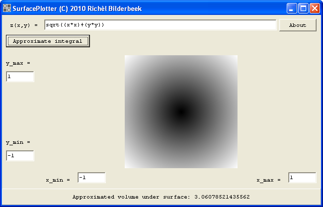

# SurfacePlotter (VCL)

Plots a user-defined two-dimensional function.

SurfacePlotter (VCL) is one of [Richèl Bilderbeek's tools](https://richelbilderbeek.github.io/tools/).

## Links

- [Source code](https://github.com/richelbilderbeek/SurfacePlotterVcl)
- [Richèl Bilderbeek's tools](https://richelbilderbeek.github.io/tools/)
